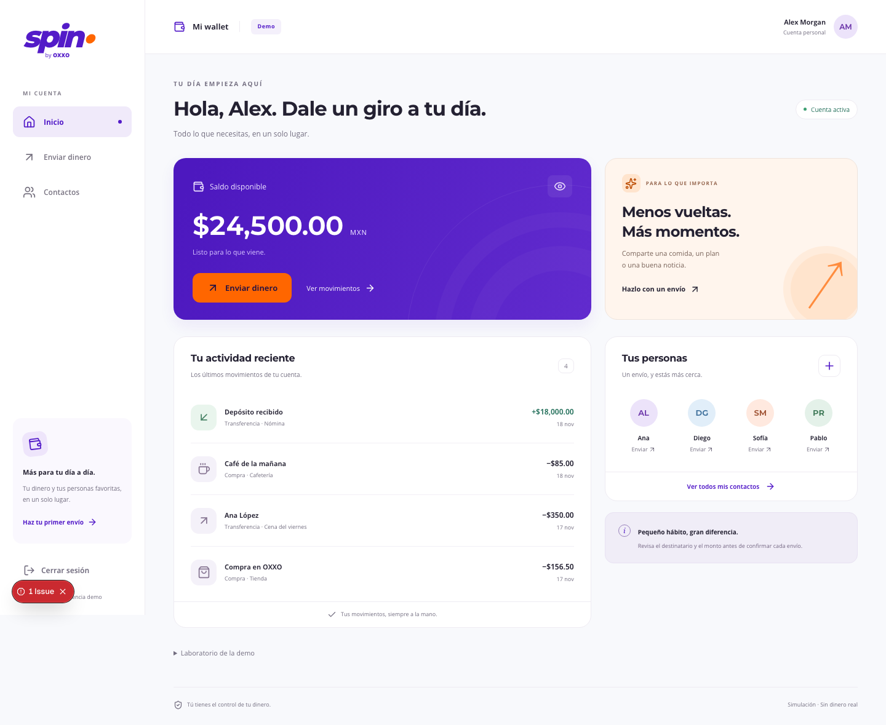

# Spin · Mini Wallet

Una simulación de wallet construida con Next.js y TypeScript. Permite iniciar una sesión demo, consultar saldo y movimientos, guardar contactos, revisar un envío y obtener su comprobante. Incluye escenarios de fallo reproducibles y protección contra cargos duplicados.

**No mueve dinero real ni autentica identidades.** Está diseñada para ejecutarse como un único proceso local de Node.js.

## Vista previa



[Login](docs/screenshots/login.png) · [Móvil](docs/screenshots/home-mobile.png) · [Revisión del envío](docs/screenshots/review.png) · [Comprobante](docs/screenshots/receipt.png)

## Ejecutar

Node compatible: `^20.19.0 || ^22.13.0 || >=24.0.0`. `.nvmrc` selecciona Node 24; la verificación local se realizó con Node 20.20.1 y npm 10.8.2.

```bash
npm ci
cp .env.example .env.local
npm run dev
```

Abre [localhost:3000](http://localhost:3000). Pulsa **Usar cuenta de prueba** y después **Entrar a mi wallet**. También acepta un correo válido o un teléfono mexicano de 10 dígitos. No se requiere contraseña.

Para usar otro puerto:

```bash
npm run dev -- --port 3100
```

### Compilación de producción local

```bash
npm run build
npm start
```

Los datos se reinician al cambiar de proceso. Si tenías una sesión anterior, vuelve a iniciar sesión. No ejecutes varias réplicas de esta demo: cada proceso tendría su propia memoria.

## Recorrido de evaluación

1. **Login:** usa `alex@demo.mx` o `5512345678`. `error@demo.mx` produce un error simulado recuperable.
2. **Inicio:** saldo inicial **$24,500.00 MXN**, usuario ficticio y movimientos recientes. El icono del ojo oculta el saldo.
3. **Contactos:** crea una persona por nombre y teléfono/correo; permanece en la sesión del servidor y está disponible en transferencias.
4. **Enviar dinero:** elige contacto, ingresa monto y concepto opcional. Los atajos de monto son editables. No se cobra comisión en esta simulación.
5. **Revisar envío:** verifica destinatario, monto y total antes de confirmar. Editar conserva los datos del formulario.
6. **Comprobante:** referencia, importe, contacto, concepto y fecha en Ciudad de México. Se puede recargar y abrir desde los movimientos. **Guardar comprobante** abre la impresión del navegador; selecciona Guardar como PDF.

### Laboratorio de la demo

Con `NEXT_PUBLIC_DEMO_CONTROLS=true`, aparece un panel desplegable al final del Home y de Transferencias:

| Pantalla      | Control                                      | Qué permite comprobar                                                                                               |
| ------------- | -------------------------------------------- | ------------------------------------------------------------------------------------------------------------------- |
| Home          | Normal / Sin movimientos / Error de servicio | Carga, lista, vacío, error y recuperación sin borrar datos                                                          |
| Transferencia | Aleatorio                                    | 60% éxito; 10% cada uno: red, fondos insuficientes, timeout y desconocido                                           |
| Transferencia | Éxito                                        | Saldo actualizado y comprobante                                                                                     |
| Transferencia | Error de red                                 | Fallo 503 sin cargo; seleccionar Éxito y reintentar                                                                 |
| Transferencia | Fondos insuficientes                         | Rechazo 422 y actualización de saldo; también ocurre realmente al exceder el disponible                             |
| Transferencia | Timeout                                      | Simula un cargo confirmado cuya respuesta se perdió; **Verificar resultado** recupera el comprobante sin otro cargo |
| Transferencia | Error desconocido                            | Fallback 500; seleccionar Éxito y reintentar                                                                        |

El escenario forzado se mantiene seleccionado hasta cambiarlo; un reintento de un fallo de red forzado vuelve a fallar mientras siga seleccionado. Un pago ya confirmado devuelve siempre su comprobante, independientemente del escenario posterior.

La UI trata los errores ambiguos como operaciones pendientes: conserva la misma clave. Si sales y regresas, recupera el envío pendiente en esa pestaña mediante `sessionStorage`. El cliente también cancela solicitudes que superen **8 segundos**. El timeout demostrativo del servidor responde 504 tras 1.8 segundos para no hacer lenta la evaluación.

Si desactivas los controles y reinicias/recompilas, los headers de simulación se ignoran; las transferencias siguen siendo aleatorias. `NEXT_PUBLIC_` es configuración pública de build, nunca un secreto.

## Verificación

```bash
npm run check           # formato, lint, tipos, unitarias y build
# Equivalente:
make ci

npx playwright install chromium
npm run test:e2e        # inicia servidor de prueba en 3100 si está libre
npm run test:e2e:ui     # exploración interactiva de pruebas
npm run test:watch      # pruebas unitarias durante cambios
npm run format         # aplicar formato
```

Verificación local: **69 pruebas unitarias** y **32 casos E2E**, aprobados tanto con servidor de desarrollo como con el build de producción. Formato, lint, tipos y compilación también aprobados.

Playwright ejecuta Chromium en escritorio y viewport móvil. La emulación móvil no sustituye pruebas en Safari/iOS reales. Usa contextos de sesión independientes y datos mock locales; no llama servicios financieros externos. Las pruebas incluyen axe sobre login, Home, resumen y comprobante.

Para verificar el build de producción, deja libre el puerto 3100:

```bash
NEXT_PUBLIC_DEMO_CONTROLS=true npm run build
E2E_PRODUCTION=true npm run test:e2e
```

En PowerShell configura las variables con `$env:NEXT_PUBLIC_DEMO_CONTROLS="true"` y `$env:E2E_PRODUCTION="true"` antes del comando correspondiente.

## Estructura

```text
src/
  app/                     Rutas, layouts, errores globales y API
    (wallet)/              Rutas con comprobación de sesión en servidor
    api/                   Session, wallet, contacts y transfers
  features/
    auth/                  Formulario de acceso
    contacts/              Alta y búsqueda de contactos
    wallet/                Home y consulta de saldo/movimientos
    transfers/             Formulario, revisión, hook de estados y comprobante
  components/              Shell, proveedores y UI compartida
  lib/                     Contratos Zod, dinero, HTTP, errores y eventos de sesión
  server/                  Servicio mock, memoria de sesión y utilidades HTTP
tests/e2e/                 Flujos reales contra API y navegador
```

Los archivos `.test.ts(x)` están junto a las unidades que prueban. `next-env.d.ts` se genera automáticamente y no se versiona. `AGENTS.md` contiene las indicaciones que genera Next.js para sus herramientas.

## Librerías y propósito

| Herramienta                       | Uso                                                                             |
| --------------------------------- | ------------------------------------------------------------------------------- |
| Next.js 16 + React 19             | App Router, server layout, UI interactiva y Route Handlers                      |
| TypeScript                        | Contratos y estados discriminados, configuración estricta                       |
| Zod                               | Validación de entradas y respuestas; tipos inferidos de un contrato compartido  |
| TanStack Query                    | Caché de datos remotos, carga, error e invalidación                             |
| Lucide React                      | Iconos SVG                                                                      |
| Fontsource Montserrat / Open Sans | Fuentes locales sin solicitudes a Google en ejecución                           |
| Vitest + Testing Library          | Reglas monetarias, servicio, HTTP, formulario y hook de envío                   |
| Playwright + axe                  | API, navegación, escritorio/móvil y comprobaciones automáticas de accesibilidad |
| ESLint + Prettier                 | Análisis estático y formato consistente                                         |

Versiones exactas en `package.json` y resoluciones reproducibles en `package-lock.json`.

## Contrato HTTP

Todos los endpoints responden JSON y `Cache-Control: private, no-store`. Los errores tienen `{ "error": { "code": "…", "message": "…" } }`.

| Método y ruta            | Uso                                                                         |
| ------------------------ | --------------------------------------------------------------------------- |
| `POST /api/session`      | `{ identity }`; crea cookie HttpOnly y una sesión nueva                     |
| `DELETE /api/session`    | Revoca sesión y elimina cookie                                              |
| `GET /api/wallet`        | Usuario, `id` público de wallet, saldo en centavos, contactos y movimientos |
| `POST /api/contacts`     | `{ walletId, name, identity }`; valida sesión y duplicados                  |
| `POST /api/transfers`    | `{ walletId, recipientId, amountCents, concept, idempotencyKey }`           |
| `GET /api/transfers/:id` | Comprobante de una transferencia perteneciente a la sesión                  |

`walletId` identifica la generación de la wallet; no concede acceso. La cookie sigue siendo necesaria. Vincular las escrituras a esa generación evita confirmar un envío revisado bajo otra sesión. Los cambios de sesión invalidan las vistas de otras pestañas mediante `BroadcastChannel`; el servidor vuelve a comprobar la generación aunque el evento no llegue.

## Límites conocidos

- **Mock de un proceso:** memoria volátil, sin base de datos, ledger contable, colas ni proveedor de pagos. Reiniciar el proceso borra sesiones, contactos y transferencias.
- **Sesión ficticia:** cualquier identidad válida abre una wallet nueva con el mismo usuario y saldo inicial. No hay verificación de identidad, contraseña ni autorización de operaciones reales. Duración máxima: 24 horas.
- **Idempotencia local:** se conserva durante la vida de la sesión/proceso; no es una garantía distribuida ni durable ante reinicios. `sessionStorage` solo recupera pendientes en la misma pestaña y si el navegador lo permite. Si está bloqueado, el reintento funciona mientras se mantenga la pantalla, pero no se garantiza la recuperación tras recargar.
- **Datos demostrativos:** los movimientos iniciales son una muestra reciente, no el historial completo que explica el saldo. Home muestra hasta 8 movimientos recientes.
- **Límites de memoria:** hasta 500 sesiones activas, 50 contactos por sesión y 500 transferencias confirmadas por sesión. No sustituyen rate limiting ni medidas contra abuso.
- **Sin internacionalización:** textos en español, moneda MXN, fechas visibles en Ciudad de México.
- **Comprobante:** impresión del navegador, sin PDF firmado ni validez bancaria.
- **Accesibilidad:** hay pruebas automáticas, foco visible, semántica y movimiento reducido; no constituyen una certificación ni sustituyen la revisión con lectores de pantalla.
- **Dependencias de desarrollo:** al verificar el 18 de noviembre de 2026, `npm audit` reportó una alerta de ReDoS en `picomatch <=4.0.7`, propagada a herramientas de lint/tests. No había una versión corregida publicada en el registro consultado. `npm audit --omit=dev` reportó **0 vulnerabilidades**. No se forzaron downgrades incompatibles; conviene volver a auditar antes de integrar o publicar.

## Decisiones y uso de IA

- [DECISIONS.md](DECISIONS.md): arquitectura, alternativas, edge cases y evolución a producción.
- [AI_USAGE.md](AI_USAGE.md): herramientas utilizadas, revisión, correcciones y responsabilidad de validación humana.

## Tiempo invertido

Registro de trabajo asistido de esta versión: aproximadamente **35 minutos transcurridos en sesiones activas**, el 18 de noviembre de 2026, en los intervalos 00:32–01:00 y 13:44–13:51, hora de Ciudad de México. Se excluye la pausa entre sesiones. Incluye implementación, pruebas y documentación; no equivale a horas de programación manual del candidato.

La lectura y conversación previas y la revisión/práctica personal posterior no están medidas en esos intervalos. **Antes de entregar, sumar el tiempo personal real para declarar la dedicación total.**
